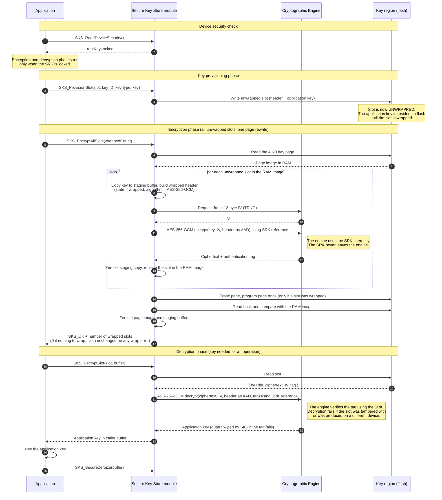
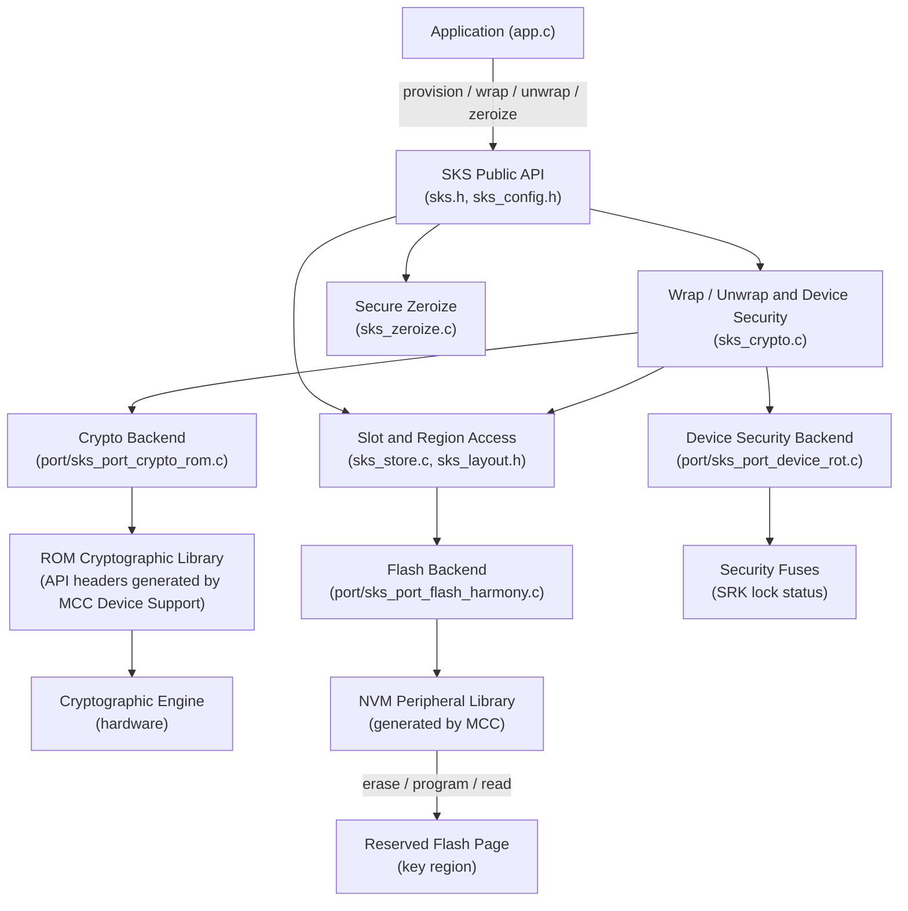

# Security Feature - Key Encryption and Decryption using Storage Root Key

## Introduction

This document describes the **Key Encryption and Decryption** security feature implemented using the **PIC32CX-BZ6** and **PIC32CX-BZ3 / PIC32CX-BZ36** SoC families. The feature enables application-level keys and other sensitive assets to be securely wrapped (encrypted) and unwrapped (decrypted) using a device-unique **Storage Root Key (SRK)** that is permanently fused into the device hardware and cannot be read, modified, or extracted by software.

By binding protected data to the SRK, encrypted keys can be safely stored in non-volatile memory, ensuring that they remain unusable if extracted from the device or moved to a different part (see [How the SRK protects application keys](#how-the-srk-protects-application-keys) for a high-level overview of this flow). This document explains the underlying cryptographic mechanism, the firmware module that implements it, and how application developers can use and reuse this module to protect their keys throughout the product lifecycle.


## How the SRK protects application keys

### What the SRK is

The Storage Root Key is a **device-unique 256-bit symmetric secret** that is permanently provisioned into the SoC and used as the root of trust for this feature. Its behaviour is defined by the following properties:

- **Key type and size.** A 256-bit symmetric value, sized to be used directly as an AES-256 key by the on-chip cryptographic engine.
- **Storage medium.** Held in a dedicated on-die **eFuse** (one-time-programmable) region of the SoC. eFuse bits can only transition from an unburned to a burned state and never the reverse. Once the SRK has been programmed and locked, it cannot be modified, cleared, or re-provisioned by software, reset, or debugger access.
- **Per-device uniqueness.** Each device is provisioned with its own independently generated random value, so no two devices share the same SRK. This uniqueness is what binds a wrapped record to a specific part.
- **Isolation from software.** The eFuse cells that hold the SRK are wired only into the internal key input of the cryptographic engine. **No register, no memory-mapped address, and no debug interface** allows the CPU (or an external debugger) to read the SRK value. It is invisible to the application, to the operating system, and to firmware executing at any privilege level.
- **Cryptographic role in this feature.** The SRK acts as the **root Key-Encryption Key (KEK)** for wrapping application keys under AES-256-GCM. Combined with the per-device uniqueness above, this means a wrapped record produced on one part cannot be unwrapped on any other part, even if the record format and the underlying algorithm are public.

### SRK provisioning status

The SRK must be provisioned and locked before any application key is wrapped. On a device whose SRK has not been provisioned, the cryptographic engine uses a **non-unique default key**: wrapping still works, but the wrapped keys are not protected.

The firmware module therefore exposes the SRK lock status (`SKS_ReadDeviceSecurity()`, field `rootKeyLocked`), and the reference application wraps and unwraps keys only when the SRK is locked. Provisioning the SRK itself is outside the scope of this document.

### How the SRK is used

At a high level, the SRK is used as the **root of trust** for protecting every other key the application handles:

- When the application has a sensitive key to protect (for example a network key, a session key, or a provisioned credential), it hands the application key to the cryptographic engine and requests an encryption operation that references the SRK.
- The cryptographic engine internally uses the SRK to encrypt the application key and returns the **wrapped (ciphertext) key** to the application. The SRK itself never crosses the boundary of the engine.
- The wrapped key can then be stored in non-volatile memory, because without the SRK it is just opaque data. The firmware module described in this document stores it in a reserved page of internal flash.
- When the key is needed again, the application passes the wrapped key back to the cryptographic engine, which decrypts and verifies it internally — once again using the SRK — and returns the application key. The application uses the key for the intended cryptographic operation and then erases it from RAM.

Because the SRK is **unique to each device and permanently fused in hardware**, a wrapped key produced on one device cannot be decrypted on any other device. This effectively **binds every protected key to the specific SoC** on which it was created, giving the application a simple but strong mechanism to keep its keys confidential over the entire product lifecycle.

## Flash region layout for key storage

> **Note.** The sections above describe the feature at a conceptual level. The remainder of this document covers the implementation in the PIC32CX-BZ3 and PIC32CX-BZ6 reference applications: the flash layout for stored keys, the operational flow at runtime, the firmware module that provides the service (the **Secure Key Store**, SKS), how to reserve the key region in flash, and how to reuse the module in another application.

From this point on, the term **application key** refers to the plaintext key that the application needs to protect with the SRK.

The PIC32CX-BZ3 and PIC32CX-BZ6 SoCs do not provide a dedicated secure-storage region in which application keys can be held in protected form at rest. For this reason, the application reserves one page of program flash — the **key region** — in which each application key is stored, once wrapped, only in its **wrapped** (encrypted under the SRK) form. The region is divided into equally sized **slots**, each of which holds exactly one application key.

| Device family | Reference device | Key region | Placement |
|---|---|---|---|
| PIC32CX-BZ3 | PIC32CX5109BZ31048 | `0x0107B000` – `0x0107BFFF` (4 KB) | Directly below the Persistent Data Storage (PDS) region at `0x0107C000` |
| PIC32CX-BZ6 | PIC32CX2051BZ62132 | `0x011FF000` – `0x011FFFFF` (4 KB) | Last page of program flash (PDS is located in boot flash on this device) |

```
Key region (one 4 KB flash page):

    base + 0x000  +----------------------------------+ ----+
                  |  Slot 0                  (124 B) |     |
    base + 0x07C  +----------------------------------+     |
                  |  Slot 1                  (124 B) |     |
    base + 0x0F8  +----------------------------------+     |
                  |  Slot 2                  (124 B) |     |  33 slots
    base + 0x174  +----------------------------------+     |  x 124 B
                  |  . . .                           |     |  = 4092 B
    base + 0xF80  +----------------------------------+     |
                  |  Slot 32                 (124 B) |     |
    base + 0xFFC  +----------------------------------+ ----+
                  |  Unused                    (4 B) |
    base + 0x1000 +----------------------------------+

    base = 0x0107B000 (PIC32CX-BZ3)  /  0x011FF000 (PIC32CX-BZ6)
    Slot n starts at base + n x 124.
```

Each slot is 124 bytes wide and holds exactly one application key of up to **64 bytes**. At any time a slot is in one of three states:

- **Empty** — erased flash (all bytes `0xFF`). No key is stored.
- **Unwrapped** — the slot holds a provisioned plaintext application key that has not yet been encrypted under the SRK.
- **Wrapped** — the slot holds the application key encrypted under the SRK, together with its IV and authentication tag.

Any other slot content is treated as invalid and is rejected by the module.

> **Note.** The fixed-slot allocation shown above is the current implementation. Future revisions may replace it with a linked-list format that packs variable-size records back-to-back, allowing the number of protected keys to grow dynamically within the reserved region.

### Slot structure

Unwrapped and wrapped slots use the same 124-byte structure. Every field is at a fixed offset; the state byte in the header tells which content the slot holds.

```
    Byte
   offset
       0  +-----------------------------------------+
          | Header                       (32 bytes) |
      32  +-----------------------------------------+
          | Key payload                  (64 bytes) |
          |   Unwrapped: plaintext application key  |
          |   Wrapped:   ciphertext                 |
          |   Bytes beyond the key length: 0xFF     |
      96  +-----------------------------------------+
          | Initialisation vector (IV)   (12 bytes) |
          |   Unwrapped: 0xFF                       |
          |   Wrapped:   random IV                  |
     108  +-----------------------------------------+
          | Authentication tag           (16 bytes) |
          |   Unwrapped: 0xFF                       |
          |   Wrapped:   AES-GCM tag                |
     124  +-----------------------------------------+
```

### Header structure

```
    Byte
   offset
       0  +-----------------------------------------+
          | Magic                         (4 bytes) |
       4  +-----------------------------------------+
          | Format version                 (1 byte) |
       5  +-----------------------------------------+
          | Slot index                     (1 byte) |
       6  +-----------------------------------------+
          | Key ID                         (1 byte) |
       7  +-----------------------------------------+
          | Key type                       (1 byte) |
       8  +-----------------------------------------+
          | State                          (1 byte) |
       9  +-----------------------------------------+
          | Encryption algorithm           (1 byte) |
      10  +-----------------------------------------+
          | Application key length        (2 bytes) |
      12  +-----------------------------------------+
          | Reserved                     (20 bytes) |
      32  +-----------------------------------------+
```

| Offset | Size | Field | Unwrapped slot | Wrapped slot |
|---|---|---|---|---|
| 0 | 4 | Magic | `0x4B455931` ("KEY1"), 32-bit little-endian | same |
| 4 | 1 | Format version | `0x01` | `0x01` |
| 5 | 1 | Slot index | Physical slot index (0 – 32) | unchanged |
| 6 | 1 | Key ID | Application-defined key identifier | unchanged |
| 7 | 1 | Key type | See the key type table below | unchanged |
| 8 | 1 | State | `0xA5` (unwrapped) | `0x5A` (wrapped) |
| 9 | 1 | Encryption algorithm | `0x00` (none) | `0x01` (AES-256-GCM) |
| 10 | 2 | Application key length | 1 – 64 bytes, little-endian | unchanged |
| 12 | 20 | Reserved | `0xFF` | `0xFF` |

| Key type | Value |
|---|---|
| AES-128 key | `0x01` |
| AES-256 key | `0x02` |
| ECC P-256 private key | `0x03` |
| HMAC-SHA256 key | `0x04` |
| Raw / other | `0xFF` |

The complete 32-byte header of the wrapped slot (with the state and algorithm fields already set to their wrapped values) is fed to AES-GCM as **Associated Data (AAD)**. The header is not encrypted, but it is bound into the authentication tag: any modification of a header byte causes tag verification to fail during decryption. No separate CRC is needed.

When a slot is wrapped, the module rewrites it in place: the state, algorithm, payload, IV and tag fields change and the plaintext key is no longer present in flash.

## Key Provisioning, Encryption and Decryption Flow

The following sequence diagram shows the phases of this feature as implemented in the reference application:

- The **device security check** reads the SRK lock status. The encryption and decryption phases run only when the SRK is locked.
- The **key provisioning phase** writes an application key into an empty slot in its unwrapped form.
- The **encryption phase** wraps every unwrapped slot under the SRK with one call to `SKS_EncryptAllSlots()`. All slots are wrapped in RAM and the key page is rewritten **once**, however many slots were unwrapped. It runs on every boot; already wrapped and empty slots are skipped, and when no slot is unwrapped the flash is not touched.
- The **decryption phase** retrieves an application key from its wrapped form every time the application needs to use it.



Key points illustrated by the flow:

- **IV / nonce** is generated by the on-chip TRNG for every encryption operation. It is stored in the slot so that the same value can be presented during decryption. It does not need to be kept secret.
- **Authentication tag** is produced by AES-GCM and stored with the ciphertext. During decryption, the cryptographic engine recomputes and verifies this tag; any modification of the header, ciphertext, IV, or tag — or an attempt to decrypt on a different device — causes the operation to fail. The module then wipes the output buffer and returns `SKS_ERR_TAG_VERIFY`.
- **SRK reference** is passed to the cryptographic engine as a handle to an internal hardware key slot. The application code never sees the SRK value itself; the engine performs all cryptographic operations that require it on-chip.
- **Slot header** carries the metadata needed to interpret the slot: magic, format version, slot index, key ID, key type, state, encryption algorithm and key length. It is not confidential, but it is bound into the AES-GCM computation as AAD, so any modification is detected during tag verification.
- **Page update.** The flash erase unit is a 4 KB page, so any slot write updates the whole page: the page is read into RAM, modified, erased and then programmed back; the other slots in the page are preserved. `SKS_EncryptAllSlots()` and provisioning of several slots modify all slots in the RAM image first and rewrite the page once. After `SKS_EncryptAllSlots()` programs the page, the flash content is read back and compared with the RAM image; a mismatch is reported as `SKS_ERR_FLASH`.
- **All-or-nothing wrap.** If any slot cannot be wrapped (TRNG or cryptographic error), `SKS_EncryptAllSlots()` does not touch the flash: every unwrapped slot stays unwrapped and can be wrapped by a later call.
- **Zeroization of the application key.** The module zeroizes every RAM copy it makes — the staging copy of the plaintext key, the ciphertext buffer and the 4 KB page image, which can contain the plaintext of unwrapped slots — before the function returns, on success and on failure. It also wipes the caller's output buffer whenever decryption fails. After a successful `SKS_DecryptSlot()`, the application must erase the returned key with `SKS_SecureZeroize()` as soon as it has been used. `SKS_SecureZeroize()` uses volatile writes so that the compiler cannot optimize the wipe away. This limits the window in which a memory-dump or fault-injection attack could recover the application key.

## Application Structure

The feature is implemented as one self-contained firmware module, the **Secure Key Store (SKS)**, located in the `secure_key_store/` folder. It sits between the application code (which owns the application keys) and the device services (cryptographic library, flash controller and security fuses). Splitting the code this way keeps security-sensitive logic — SRK usage, IV generation, application-key zeroization, and on-flash slot handling — isolated from the rest of the application and makes each piece independently reviewable and testable.

The module does not produce any console output. All status reporting is done by the application from the result codes the module returns.

### Module block diagram



The SKS public API (`sks.h`) is the only entry point the application uses. Everything below it is internal: the private headers stop compilation with an error if they are included from outside the module. All hardware access is isolated in the `port/` backends, which can be replaced (for example to support another device or another flash driver) without changing the API exposed to application code.

### Modules and files

| File | Role |
|---|---|
| `sks.h` | **Public API** — the only module header the application includes. Declares the functions, the result codes, the key type values, the limits `SKS_MAX_SLOTS` / `SKS_MAX_APP_KEY_SIZE` and the device security structure. |
| `sks_config.h` | **Module configuration** — includes the project's `sks_user_config.h`, checks that the required values are defined and provides defaults for the optional ones. Included by `sks.h`. |
| `sks_crypto.c` | **Wrap / unwrap** — implements `SKS_PlatformInit()`, `SKS_CryptoOps_Init()`, `SKS_EncryptAllSlots()`, `SKS_EncryptSlot()`, `SKS_DecryptSlot()` and `SKS_ReadDeviceSecurity()`: slot state checks, header handling, IV generation, AES-256-GCM with the SRK, and zeroization of the plaintext and ciphertext copies. |
| `sks_store.c` | **Slot and region access** — bounded read / erase / program of the key region, the page update used to write a single slot, and the batch page access (load the page into RAM, rewrite it once, read back and compare) used by `SKS_EncryptAllSlots()`; owns the 4 KB page buffer, which is zeroized after every operation; implements `SKS_ProvisionSlot()`. |
| `sks_internal.h` | **Internal API** (private) — region and slot access functions shared inside the module. |
| `sks_layout.h` | **Slot format** (private) — header and slot structures, magic, state and algorithm values, slot size and offsets, with compile-time checks of the layout. |
| `sks_zeroize.c` | **Secure zeroize** — `SKS_SecureZeroize()`, a wipe that the compiler cannot optimize away. |
| `port/sks_port.h` | **Porting interface** (private) — the flash, crypto and device-security functions each backend implements, and the compiler abstraction macros. |
| `port/sks_port_flash_harmony.c` | **Flash backend** — erase / program / read of the key region on top of the MCC-generated NVM peripheral library. Checks the configured region against the linker-script reservation before any erase or program operation. |
| `port/sks_port_crypto_rom.c` | **Crypto backend** — AES-256-GCM wrap / unwrap with the SRK key reference and TRNG access through the ROM cryptographic API. Maps library status codes to SKS result codes. |
| `port/sks_port_device_rot.c` | **Device security backend** — reads the device security configuration fuses (SRK lock, debug lock, UUID lock, boot key lock). Read-only. |
| `sks_user_config.h` | **Project configuration** (in the application folder, not in the module) — key region address and size, flash geometry and SRK key index. See [Configurable parameters](#configurable-parameters). |
| `app.c` | **Application** — calls the SKS API and performs all console output (see below). |

The crypto and device-security backends are the only device-family-specific files: the PIC32CX-BZ3 and PIC32CX-BZ6 reference projects each contain the version that matches the MCC-generated headers of their device. All other module files are identical in both projects.

### Public API

| Function | Purpose |
|---|---|
| `int SKS_PlatformInit(void)` | Enables the cryptographic engine clock. Call once from the application initialisation, before any other SKS function. |
| `int SKS_CryptoOps_Init(void)` | Initialises the TRNG. Call once at startup; must succeed before keys can be wrapped. |
| `int SKS_ReadDeviceSecurity(SKS_DeviceSecurity_t *out)` | Reads the device security state. `out->rootKeyLocked` tells whether the SRK is provisioned and locked; the debug, UUID and boot-key lock flags are reported as well. |
| `int SKS_ProvisionSlot(uint8_t slotIndex, uint8_t keyId, uint8_t keyType, const uint8_t *key, uint16_t keyLen)` | Writes an application key of 1 – 64 bytes into an **empty** slot in unwrapped form. Call `SKS_EncryptAllSlots()` (or `SKS_EncryptSlot()` for this slot) right afterwards to keep the time the plaintext key is in flash short. |
| `int SKS_EncryptAllSlots(uint8_t *wrappedCount)` | Wraps **every** unwrapped slot with AES-256-GCM / SRK in RAM and rewrites the key page **once**, then reads the page back and compares it with the RAM image. All-or-nothing: if any wrap fails, flash is unchanged. Returns `SKS_OK` and the number of wrapped slots (0 and no flash write when nothing is unwrapped); `SKS_ERR_FLASH` on a flash error or read-back mismatch. Recommended way to wrap keys: wrapping N slots costs one page rewrite instead of N. |
| `int SKS_EncryptSlot(uint8_t slotIndex)` | Wraps the unwrapped key in the slot with AES-256-GCM / SRK and rewrites the key page (one page rewrite per call). Returns `SKS_ERR_ALREADY_ENC` for a wrapped slot and `SKS_ERR_EMPTY_SLOT` for an empty slot. Use it when a single key has to be wrapped. |
| `int SKS_DecryptSlot(uint8_t slotIndex, uint8_t *plaintextKeyOut, uint16_t bufLen, uint16_t *keyLenOut)` | Verifies and unwraps the key in a wrapped slot into the caller's buffer (4-byte aligned, at least the key length). |
| `void SKS_SecureZeroize(void *buf, size_t len)` | Erases key material from RAM. |

Every function except `SKS_SecureZeroize()` returns one of these result codes:

| Code | Value | Meaning |
|---|---|---|
| `SKS_OK` | 0 | Success |
| `SKS_ERR_ALREADY_ENC` | 1 | Slot is already wrapped — no action taken |
| `SKS_ERR_EMPTY_SLOT` | 2 | Slot is empty |
| `SKS_ERR_INVALID_STATE` | 3 | Slot content or state is not valid for the call |
| `SKS_ERR_FLASH` | 4 | Flash read, erase or program failed |
| `SKS_ERR_TRNG` | 5 | Random number generation failed |
| `SKS_ERR_CRYPTO` | 6 | AES-GCM operation failed |
| `SKS_ERR_BUF_TOO_SMALL` | 7 | Output buffer is smaller than the stored key |
| `SKS_ERR_TAG_VERIFY` | 8 | Authentication tag mismatch — key rejected, output buffer wiped |
| `SKS_ERR_INVALID_PARAM` | 9 | NULL pointer or invalid argument |

The functions share static buffers and are **not reentrant**: call them sequentially from a single task.

### Application entry point (`app.c`)

The reference application keeps all feature-related logic in `app.c` and the console output in the application only. Its responsibilities are:

1. **Initialisation (`APP_Initialize()`).** After the standard board and peripheral initialisation performed by `SYS_Initialize()` (clocks, console UART, NVM controller), call `SKS_PlatformInit()` once and then `SKS_CryptoOps_Init()`. If the TRNG cannot be initialised, report the error; `SKS_EncryptAllSlots()` then fails with `SKS_ERR_TRNG` instead of wrapping a key without a valid IV, and flash stays unchanged.
2. **Device security check.** Call `SKS_ReadDeviceSecurity()` and report the SRK lock status. If the SRK is not locked, skip the encryption and decryption phases.
3. **Key provisioning.** Provision the application keys with `SKS_ProvisionSlot()`. The reference application provisions demonstration keys into slots 0 – 2 on the first boot; slots that are already in use are left unchanged.
4. **Encryption phase.** Call `SKS_EncryptAllSlots()` once and report the result and the number of wrapped slots. Already wrapped and empty slots are skipped by the module, so wrapping all provisioned keys costs a single page rewrite on the first boot, and on later boots the key page is not written at all.
5. **Decryption phase.** Call `SKS_DecryptSlot()` when a key is needed, use the key, and erase it immediately with `SKS_SecureZeroize()`. The reference application decrypts every wrapped slot once at startup to demonstrate the flow and reports only the key length — never the key bytes.

#### Expected console output

The reference application prints a summary of each phase over the console UART. The example below shows the two cases that occur in practice.

First boot — the demonstration keys are provisioned and then wrapped in the same boot:

```
--- APP KEY MANAGER ---
  Storage Root Key : provisioned and locked
  Debug access     : open
  Secure boot key  : not locked
  Provisioned      : 3 new key(s)
  Wrapped          : 3 key(s)

--- Key usage example ---
  Slot 0: key unwrapped and used (16 bytes), then erased
-------------------------
```

Subsequent boots — the keys are already provisioned and wrapped in flash, so the key page is not written:

```
--- APP KEY MANAGER ---
  Storage Root Key : provisioned and locked
  Debug access     : open
  Secure boot key  : not locked
  Provisioned      : 0 new key(s) (already provisioned)
  Wrapped          : 0 key(s) (all keys already wrapped)

--- Key usage example ---
  Slot 0: key unwrapped and used (16 bytes), then erased
-------------------------
```

How the fields map to the API:

| Console line | Source |
|---|---|
| `Storage Root Key` | `SKS_ReadDeviceSecurity()`, field `rootKeyLocked` |
| `Debug access`, `Secure boot key` | `SKS_ReadDeviceSecurity()`, debug and boot-key lock flags |
| `Provisioned` | Number of slots written by `SKS_ProvisionSlot()` in this boot; slots already in use are reported as "already provisioned" |
| `Wrapped` | `wrappedCount` returned by `SKS_EncryptAllSlots()` |
| `Slot n: key unwrapped and used (N bytes), then erased` | `keyLenOut` from `SKS_DecryptSlot()`, followed by `SKS_SecureZeroize()`. Only the length is printed. |

The `Debug access : open` and `Secure boot key : not locked` lines show the state of a development board. On a production device, these should read as locked (see [Firmware integrity](#design-considerations)).

### Directory layout

The `config/default/` sub-tree and everything below it is generated by MCC. The `driver/security/` folder in particular is produced by the **Device Support** component and exposes the cryptographic API of the device ROM to the application.

```
firmware/
└── src/
    ├── app.c, app.h
    ├── sks_user_config.h                          (project configuration of the SKS module)
    ├── secure_key_store/                          (SKS module)
    │   ├── sks.h                     sks_config.h
    │   ├── sks_internal.h            sks_layout.h
    │   ├── sks_crypto.c              sks_store.c
    │   ├── sks_zeroize.c
    │   └── port/
    │       ├── sks_port.h
    │       ├── sks_port_flash_harmony.c
    │       ├── sks_port_crypto_rom.c
    │       └── sks_port_device_rot.c
    └── config/default/                            (MCC-generated)
        ├── PIC32CX5109BZ31048.ld                  (linker script, PIC32CX-BZ3 —
        │                                           PIC32CX2051BZ62132.ld on PIC32CX-BZ6)
        ├── initialization.c, startup_xc32.c, ...  (device startup, clocks, PPS)
        ├── peripheral/nvm/                        (NVM peripheral library)
        └── driver/
            ├── device_support/                    (device support library and headers)
            └── security/
                ├── api_table.h                    (ROM cryptographic API table)
                ├── <symmetric-crypto headers>/    (AEAD, block cipher, hash, MAC,
                │                                   TRNG, key reference, ...)
                └── <public-key-crypto headers>/   (ECC, RSA, DSA, Ed25519/448, ...)
```

### External dependencies

- **Cryptographic library (MCC Device Support component).** The library itself is resident in the device ROM. The API headers under `driver/security/` — a symmetric-crypto set covering AEAD, block cipher, hash, MAC, TRNG and key reference, and a public-key-crypto set covering ECC, RSA, DSA, Ed25519 / Ed448 — are generated automatically by the **Device Support** component in MPLAB Code Configurator when the project is configured for the target device. All cryptographic-engine access by the module goes through these headers.
- **Flash driver (MCC NVM peripheral library).** The program flash erase, program and read primitives are provided by the MCC-generated NVM peripheral library (`plib_nvm.h` / `plib_nvm.c` under `config/default/peripheral/nvm/`). `NVM_Initialize()` is called by `SYS_Initialize()`. The module's flash backend is a thin adapter over this library.
- **Device register definitions.** The device security backend uses the register definitions of the device family pack through the MCC-generated `device.h`.
- **Device startup and peripheral initialisation.** The rest of the `config/default/` tree (clock tree, interrupt vectors, PPS pin muxing, startup and initialisation files) is also produced by MCC; the application does not maintain any of it by hand.
- **Linker script.** Reserves the key region at a fixed, page-aligned address so that the module can erase and rewrite it without disturbing application code or read-only data (see the next section).

## Reserving the key region in flash

The key region must be excluded from the memory the linker uses for application code and data; otherwise the linker could place code there and the module would erase it. Two cooperating edits in the device linker script (`config/default/PIC32CX5109BZ31048.ld` on PIC32CX-BZ3, `config/default/PIC32CX2051BZ62132.ld` on PIC32CX-BZ6) reserve the region, and the module configuration must describe the same region.

### Step 1 — Define the region macros and shrink the code region

Add the key region macros next to the other memory-region macros and reduce `ROM_LENGTH` by the size of the key region.

PIC32CX-BZ3 — key region directly below PDS:

```
#ifndef SECURE_KEY_STORAGE_LENGTH
#  define SECURE_KEY_STORAGE_LENGTH 0x1000                 /* one 4 KB page */
#endif

#ifndef SECURE_KEY_STORAGE_ORIGIN
#  define SECURE_KEY_STORAGE_ORIGIN (PDS_ORIGIN - SECURE_KEY_STORAGE_LENGTH)
                                    /* = 0x0107C000 - 0x1000 = 0x0107B000 */
#endif

#ifndef ROM_LENGTH
#  define ROM_LENGTH 0x7FE00 - PDS_LENGTH - SECURE_KEY_STORAGE_LENGTH
#elif (ROM_LENGTH > (0x7FE00 - PDS_LENGTH - SECURE_KEY_STORAGE_LENGTH))
#  error ROM_LENGTH exceeds allowed size (PDS + secureKeyStorage reserved)
#endif
```

PIC32CX-BZ6 — key region at the end of program flash:

```
#ifndef PFM_END_ADDRESS
#  define PFM_END_ADDRESS 0x1200000                        /* end of program flash */
#endif

#ifndef SECURE_KEY_STORAGE_LENGTH
#  define SECURE_KEY_STORAGE_LENGTH 0x1000                 /* one 4 KB page */
#endif

#ifndef SECURE_KEY_STORAGE_ORIGIN
#  define SECURE_KEY_STORAGE_ORIGIN (PFM_END_ADDRESS - SECURE_KEY_STORAGE_LENGTH)
                                    /* = 0x01200000 - 0x1000 = 0x011FF000 */
#endif

#ifndef ROM_LENGTH
#  define ROM_LENGTH (0x1ffe00 - SECURE_KEY_STORAGE_LENGTH)
#elif (ROM_LENGTH > (0x1ffe00 - SECURE_KEY_STORAGE_LENGTH))
#  error ROM_LENGTH exceeds allowed size (secureKeyStorage reserved at end of Program Flash)
#endif

#if ((SECURE_KEY_STORAGE_ORIGIN % 0x1000) != 0) || ((SECURE_KEY_STORAGE_LENGTH % 0x1000) != 0)
#  error secureKeyStorage must be 4 KB page aligned and a multiple of 4 KB in size
#endif
#if (SECURE_KEY_STORAGE_ORIGIN < (ROM_ORIGIN + ROM_LENGTH))
#  error secureKeyStorage overlaps the rom (application code) region
#endif
#if ((SECURE_KEY_STORAGE_ORIGIN + SECURE_KEY_STORAGE_LENGTH) > PFM_END_ADDRESS)
#  error secureKeyStorage extends beyond the end of Program Flash
#endif
```

The `#error` checks are recommended for both device families: they stop the build if the reservation is misaligned or overlaps the code region.

### Step 2 — Add the memory region

Add a read-only `securekey` entry to the `MEMORY` command:

```
MEMORY
{
  rom       (LRX)  : ORIGIN = ROM_ORIGIN,                LENGTH = ROM_LENGTH
  securekey (R)    : ORIGIN = SECURE_KEY_STORAGE_ORIGIN, LENGTH = SECURE_KEY_STORAGE_LENGTH
  ...
}

#ifndef SECURE_KEY_STORAGE_REGION
#define SECURE_KEY_STORAGE_REGION securekey
#endif
```

### Step 3 — Add the NOLOAD output section

Add the section inside `SECTIONS`, after the code sections:

```
    .secureKeyStorage (NOLOAD) :
    {
        __secure_key_storage_start = .;
        . = . + SECURE_KEY_STORAGE_LENGTH;
        __secure_key_storage_end = .;
    } > SECURE_KEY_STORAGE_REGION
```

Because the section is declared `NOLOAD`, nothing is emitted into the firmware image for those addresses: the slots are written at run time by the module. The exported start / end symbols let the flash backend verify, before every erase or program operation, that the region configured in `sks_user_config.h` is exactly the region reserved by the linker. On a mismatch, the operation is refused and `SKS_ERR_FLASH` is returned, so a stale configuration can never erase application code.

### Step 4 — Configure the module

Set the same address and size in `sks_user_config.h`:

```c
#define SKS_REGION_BASE_ADDR        0x011FF000UL   /* 0x0107B000UL on PIC32CX-BZ3 */
#define SKS_REGION_SIZE             0x1000U
#define SKS_FLASH_PAGE_SIZE         4096U
#define SKS_FLASH_PROGRAM_UNIT      1024U
#define SKS_SRK_KEY_ID              0U
```

### Step 5 — Verify the reservation

- The map file of the build lists `.secureKeyStorage` at the expected address, and the `rom` region ends where the key region starts.
- The hex file contains no data in the key region.
- At run time, the first provisioning or wrap operation succeeds (a configuration mismatch is reported as `SKS_ERR_FLASH`).

### Important notes

- **MCC regeneration.** The linker script is generated by MCC. When the project is regenerated, check the merge of the linker script and keep the key region edits.
- **Device programming.** Programming the device with a full chip erase also erases the key region: all wrapped keys are lost and must be provisioned again. If keys must survive a firmware update, the programming or bootloader update flow must not erase or write the key region.
- **Other reserved areas.** The key region must not overlap any other reserved flash area (PDS, bootloader, firmware-update image storage, and so on).

## Configurable parameters

### Linker script (`PIC32CX5109BZ31048.ld` / `PIC32CX2051BZ62132.ld`)

The XC32 linker preprocesses the linker script, so these macros can also be defined in the MPLAB X project properties or on the linker command line instead of editing their defaults in the script.

| Macro | PIC32CX-BZ3 default | PIC32CX-BZ6 default | Purpose |
|---|---|---|---|
| `SECURE_KEY_STORAGE_LENGTH` | `0x1000` | `0x1000` | Size of the key region. Must be a multiple of the 4 KB flash page; this version of the module supports one page. |
| `SECURE_KEY_STORAGE_ORIGIN` | `PDS_ORIGIN - SECURE_KEY_STORAGE_LENGTH` (`0x0107B000`) | `PFM_END_ADDRESS - SECURE_KEY_STORAGE_LENGTH` (`0x011FF000`) | Start address of the key region. Must be 4 KB page aligned and inside program flash. |
| `ROM_LENGTH` | `0x7FE00 - PDS_LENGTH - SECURE_KEY_STORAGE_LENGTH` | `0x1FFE00 - SECURE_KEY_STORAGE_LENGTH` | Size of the application code region. Must end at or below the start of the key region. |
| `SECURE_KEY_STORAGE_REGION` | `securekey` | `securekey` | Memory region the `.secureKeyStorage` section is placed in. |
| `PDS_ORIGIN` / `PDS_LENGTH` | `0x0107C000` / `0x4000` | — | PIC32CX-BZ3 only: the key region is placed directly below PDS. |
| `PFM_END_ADDRESS` | — | `0x1200000` | PIC32CX-BZ6 only: end of program flash; the key region is its last page. |

### Module configuration (`sks_user_config.h`)

| Macro | PIC32CX-BZ3 | PIC32CX-BZ6 | Purpose |
|---|---|---|---|
| `SKS_REGION_BASE_ADDR` | `0x0107B000UL` | `0x011FF000UL` | Absolute start address of the key region. Must equal `SECURE_KEY_STORAGE_ORIGIN`. Required. |
| `SKS_REGION_SIZE` | `0x1000U` | `0x1000U` | Size of the key region. Must equal `SECURE_KEY_STORAGE_LENGTH`. Required. |
| `SKS_FLASH_PAGE_SIZE` | `4096U` | `4096U` | Flash erase unit. Checked at compile time against the NVM peripheral library. Required. |
| `SKS_FLASH_PROGRAM_UNIT` | `1024U` | `1024U` | Flash program unit (row). Checked at compile time against the NVM peripheral library. Required. |
| `SKS_SRK_KEY_ID` | `0U` | `0U` | Hardware key index of the SRK. Optional, default `0`. |

### Module tuning (`sks_config.h`)

| Macro | Default | Purpose |
|---|---|---|
| `SKS_HW_MAX_RETRIES` | `100U` | Maximum retries while the cryptographic engine reports busy. |
| `SKS_IV_GEN_MAX_RETRIES` | `100U` | Maximum retries while the TRNG has no random data available. |

### Derived values (`sks.h`, not configurable)

| Value | Default | Meaning |
|---|---|---|
| `SKS_MAX_APP_KEY_SIZE` | 64 bytes | Largest application key a slot can hold (fixed by the slot format). |
| `SKS_MAX_SLOTS` | 33 | Number of slots: `SKS_REGION_SIZE / 124`. |

Compile-time checks in the module verify that the slot format has the expected size, that the region is a whole number of flash pages, that the base address is page aligned and inside program flash, and that the flash geometry matches the NVM peripheral library. The run-time check against the linker symbols (see Step 3) covers a mismatch between `sks_user_config.h` and the linker script.

## Reusing the module in another application

The module has no dependency on the reference application. To add it to another MPLAB Harmony (MCC) project for a PIC32CX-BZ3 / BZ36 or PIC32CX-BZ6 device:

1. **Configure the project in MCC.** Make sure the project contains the Device Support component (cryptographic API headers) and the NVM peripheral library, and that `SYS_Initialize()` calls `NVM_Initialize()`.
2. **Copy the module.** Copy the `secure_key_store/` folder into the project's `firmware/src/` folder. Use the crypto and device-security backends (`port/sks_port_crypto_rom.c`, `port/sks_port_device_rot.c`) that match the device family.
3. **Add the project configuration.** Create `firmware/src/sks_user_config.h` with the values described in [Configurable parameters](#configurable-parameters). The file must be on the compiler include path (`firmware/src` is on the include path of MCC-generated projects).
4. **Add the files to the project.** Add the `.c` files of `secure_key_store/` and `secure_key_store/port/` to the MPLAB X project, and add `secure_key_store` to the compiler include path so that the application can include `sks.h`.
5. **Reserve the key region.** Edit the linker script as described in [Reserving the key region in flash](#reserving-the-key-region-in-flash) and check that the region does not overlap any flash area used by the application or its stacks.
6. **Initialise the module.** In the application initialisation, after `SYS_Initialize()`:

   ```c
   #include "sks.h"

   (void)SKS_PlatformInit();
   if (SKS_CryptoOps_Init() != SKS_OK)
   {
       /* Report the error; keys cannot be wrapped without the TRNG. */
   }
   ```

7. **Provision, wrap and use the keys** from a single task:

   ```c
   SKS_DeviceSecurity_t sec;
   static uint8_t       key[SKS_MAX_APP_KEY_SIZE] __attribute__((aligned(4)));
   uint16_t             keyLen;
   uint8_t              wrapped;
   int                  r;

   if ((SKS_ReadDeviceSecurity(&sec) == SKS_OK) && sec.rootKeyLocked)
   {
       /* Store a new key (slot must be empty), then wrap every unwrapped
        * slot with a single page rewrite. */
       r = SKS_ProvisionSlot(slot, keyId, keyType, newKey, newKeyLen);
       SKS_SecureZeroize(newKey, newKeyLen);   /* source copy no longer needed */
       if (r == SKS_OK)
       {
           r = SKS_EncryptAllSlots(&wrapped);
       }

       /* Later: unwrap, use and erase the key. */
       r = SKS_DecryptSlot(slot, key, sizeof(key), &keyLen);
       if (r == SKS_OK)
       {
           /* Use key[0 .. keyLen-1] for the intended operation. */
           SKS_SecureZeroize(key, keyLen);
       }
   }
   ```

   Report the result codes from the application if console output is required; the module itself prints nothing.

### Design considerations

- **Single task.** The functions share static buffers and are not reentrant. Call them from one task, and do not run them concurrently with other software that uses the cryptographic engine.
- **Blocking flash operations.** Provisioning and wrapping erase and reprogram the 4 KB key page and block until the flash operation has completed. Use `SKS_EncryptAllSlots()` so that wrapping several keys costs a single page rewrite. Schedule these operations where the application can tolerate the delay.
- **Power loss during a page update.** A slot write erases and reprograms the whole page. A reset or power loss during this sequence can lose the content of every slot in the page. Provision and wrap keys in a controlled state (for example during production or first start-up).
- **RAM usage.** The module uses static buffers (one 4 KB page buffer plus slot-sized buffers) instead of the task stack.
- **Device-bound keys.** Wrapped keys can only be unwrapped on the device that wrapped them, and they are lost when the key region is erased. Plan how keys are provisioned again after a full chip erase or a device replacement.
- **Firmware integrity.** Any firmware running on the device can use the SRK to unwrap the stored keys. Protect the firmware (for example with secure boot) and lock the debug interface on production devices.
- **No key output.** Never print, log or transmit the plaintext or unwrapped key; erase it with `SKS_SecureZeroize()` immediately after use.
